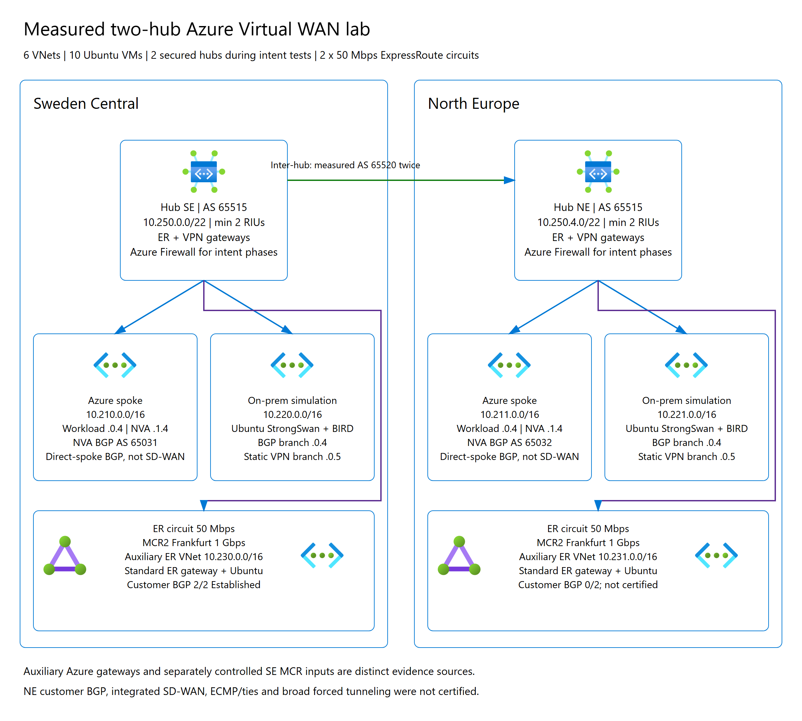
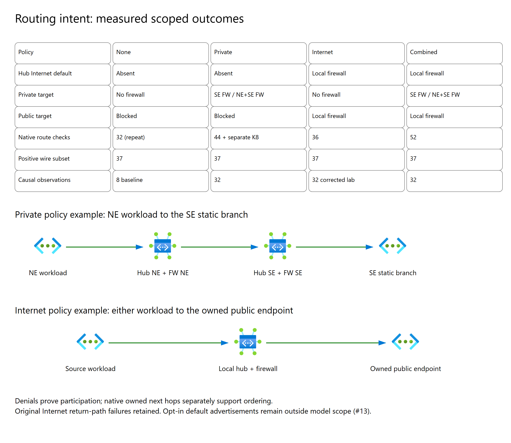

# Virtual WAN simulator: controlled Azure comparison

**Scoped evidence, not Azure certification.** This two-region lab compared the browser-only [Virtual WAN Topology Lab](https://github.com/erjosito/vwan-visual-topology) with real Azure route selection, advertisements and endpoint forwarding on 2026-10-29.

**Testing and owned-resource cleanup are complete.** Final Azure verification at 2026-10-30 00:26 UTC confirmed the lab group absent, zero remaining run-tagged resources, and the recorded external access remnants absent. All six owned provider products were decommissioned; the 72 unrelated provider product identities/states were independently verified unchanged before deleting the credential path. The production simulator remains available and was not part of the disposable lab.

The durable work log, original prediction commitments and investigation history are in [erjosito/vwan-visual-topology#5](https://github.com/erjosito/vwan-visual-topology/issues/5). Testing lessons are maintained in the application repository's [AZURE-TESTING-LESSONS.md](https://github.com/erjosito/vwan-visual-topology/blob/main/AZURE-TESTING-LESSONS.md).

## Executive findings

- Seven nominal selected-route cases matched both hubs twice, covering all three hub routing preferences, locality and longest-prefix matching. The locality/VPN case required arrival-order control and remains **history-sensitive**, not a universal pass.
- A separately frozen physical ExpressRoute post-fix case matched both native hubs twice and the production UI. Original failed predictions and observations were preserved, not rewritten.
- Fourteen actual unsecured endpoint deliveries passed, including local/remote direct-spoke NVAs and auxiliary ExpressRoute endpoints. Direct-spoke BGP is **not** integrated SD-WAN.
- Private-only, Internet-only and combined intent each completed a 32-observation causal matrix. The Internet matrix is explicitly **post-lab-correction**: four initial public timeouts remain recorded.
- All four intent configurations passed their separately frozen 37-check **positive advertisement subset**. Defaults, absent-route suppression and NE customer BGP were not certified by that subset.
- Thirteen actual production collector/import exercises passed, including acknowledgement, persistence and native JSON roundtrip, with no external requests from the imported application workspace.
- Five confirmed application defects or warning gaps were fixed, deployed and live-retested. Native auxiliary-ER representation and opt-in default-advertisement modeling remain explicit follow-ons.

## Topology



| Component | Configuration |
|---|---|
| Azure regions | Sweden Central and North Europe |
| Virtual WAN | Standard; two hubs, AS65515, minimum two routing infrastructure units each |
| Hub prefixes | SE `10.250.0.0/22`; NE `10.250.4.0/22` |
| Azure spokes | `10.210.0.0/16`, `10.211.0.0/16`; one workload and one direct-BGP NVA each |
| Simulated branches | `10.220.0.0/16`, `10.221.0.0/16`; separate BGP and static StrongSwan VPN VMs |
| Auxiliary ER VNets | `10.230.0.0/16`, `10.231.0.0/16`; Standard ER VNet gateways and endpoints |
| Compute | Ten Ubuntu 22.04 VMs, `Standard_B2ts_v2`, 30 GiB Standard SSD; no Spot instances |
| ExpressRoute | Two 50 Mbps Standard/MeteredData circuits, Stockholm and Dublin |
| Provider | Two 1 Gbps MCR2s in Frankfurt and four 50 Mbps VXCs, No Minimum Term |
| Customer BGP | SE established on both peers; NE unavailable and explicitly uncertified |
| Routing intent | Two Standard hub Azure Firewalls; no/private/Internet/combined policies |

Auxiliary gateways sharing an Azure circuit provided independently measured Azure-side ER inputs. These are **not interchangeable with a working external customer BGP session**. Later SE physical MCR injections supplied a separate controlled source.

## Results

### Export, import and route selection

| Evidence family | Result and boundary |
|---|---|
| A-01 app-generated Bicep | Actual downloaded template compiled, validated, what-if reviewed and deployed unchanged: **three resources, one WAN and two hubs**. This did not certify the separate lab-only VPN/ER/firewall infrastructure or VNet export coverage. |
| Production structural import | **13 passed**. Combined intent imported two hubs/two spokes with 14 acknowledged omission warnings. Import success is not routing parity or inferred on-premises discovery. |
| C-LOCAL ExpressRoute / VPN / ASPath | Both hubs' exact selected transport, owned next-hop origin and measured AS path matched twice. |
| C-LOCALITY VPN / ASPath | Both nominal cases matched twice; VPN only after explicit source arrival-order control. Microsoft's locality race remains material. |
| C-LPM | Both native `/16` and `/24` selections matched twice; both actual `/24` deliveries and six positive `/24` advertisement checks passed. |
| E-AS-LOCAL-ER-SHORTER | Selected-route match with calibrated, independently observed inputs; HRP-dependent ER representation remains an investigation. |
| G physical post-fix repeat | Separate immutable prediction matched both hubs twice after the remote-ER ranking fix; production selection/persistence also passed. |
| Static VPN baseline | 24 retrospective native checks; distinct from blind pre-observation certification. |
| Unsecured endpoint forwarding | 14 exact-hostname deliveries, including local/remote NVA and auxiliary ER endpoints. |
| F customer export | Nine exact positive customer Received AS paths over six prefixes matched after correcting private-AS removal at the ER customer boundary. |

### Routing intent



| Configuration | Native modeled subset | Positive wire subset | Actual forwarding |
|---|---:|---:|---|
| No intent | 32 checks repeated after firewall deployment; same baseline also verified before deployment | 37 | Eight baseline observations |
| Private only | 44 original modeled checks; separate post-fix K repeat verified eight default-table checks | 37 | 32 causal observations |
| Internet only | 36 | 37 | 32 post-correction causal observations; initial four public failures retained |
| Private + Internet | 52, no recorded differences | 37 | 32 causal observations |

Each causal matrix used both workload identities, a private and owned-public endpoint, two samples at least 30 seconds apart per source epoch, and ordered **Allow / SE-deny / NE-deny / restored-Allow** phases. Success required HTTP200 and the exact expected hostname; a wrong responder was not a pass.

Private policy required the SE firewall for the SE private target and both NE/SE firewalls for the NE-to-SE private flow. Internet policy required the source's local firewall for the public flow. Denial proves **participation**, not ordering alone; exact owned native next-hop bindings supply separate ordering evidence.

The Internet-only failure was an endpoint return-path fault: an advertised BGP default installed through XFRM at metric32 ahead of the DHCP underlay at metric100. Only two owned-firewall public `/32` response routes were added through the existing underlay. Actual lookups changed from XFRM to underlay and BGP exports stayed byte-identical. No BGP default was withdrawn and no cloud permission or route was changed to obtain a pass.

## Fixed findings and unresolved scope

| Application issue | Outcome |
|---|---|
| [erjosito/vwan-visual-topology#7](https://github.com/erjosito/vwan-visual-topology/issues/7) | Collector empty-spoke-static-route classification fixed and production collector/import retested. |
| [erjosito/vwan-visual-topology#8](https://github.com/erjosito/vwan-visual-topology/issues/8) | Locality/arrival-order warning corrected; the nominal algorithm was not silently changed. |
| [erjosito/vwan-visual-topology#10](https://github.com/erjosito/vwan-visual-topology/issues/10) | Unconditional remote-ER exclusion under ASPath removed after physical evidence; separate G repeat passed. |
| [erjosito/vwan-visual-topology#11](https://github.com/erjosito/vwan-visual-topology/issues/11) | RFC6996 private-AS removal applied only at the ER customer export boundary; real Received paths and UI retested. |
| [erjosito/vwan-visual-topology#12](https://github.com/erjosito/vwan-visual-topology/issues/12) | Private-only firewall fallback corrected without adding a hub/outbound default or replacing a learned firewall default; separate native/UI K retest passed. |
| [erjosito/vwan-visual-topology#9](https://github.com/erjosito/vwan-visual-topology/issues/9) | **Open investigation:** HRP-dependent auxiliary ER path representation; some native and receiver layers differ. |
| [erjosito/vwan-visual-topology#13](https://github.com/erjosito/vwan-visual-topology/issues/13) | **Unsupported follow-on:** per-connection opt-in Internet-default advertisements. Actual enabled VPN/ER attachments received defaults; the app does not currently model the switches. |
| [erjosito/vwan-visual-topology#6](https://github.com/erjosito/vwan-visual-topology/issues/6) | **Separate feature:** direct-spoke NVA modeling, not an assertion of integrated-SD-WAN equivalence. |

Actual VPN, ER and VNet Internet-security flags were true; omitted direct-BGP fields were recorded as unknown, not false. Observed defaults were wire AS65515 at VPN receivers and AS12076 at the SE ER customer. They remain outside the J positive-wire subset. Private-only firewall fallback is a different behavior from hub/default advertisement.

This lab does **not** certify ECMP/ties, all arrival histories, NE customer routing, integrated SD-WAN, full forced tunneling, default-switch-false behavior, all route-map combinations, absent-route suppression, or every system/native-table prefix. The app does not model firewall enforcement, SNAT or vendor-specific on-premises selection.

## Evidence and validation method

Predictions were frozen and publicly committed before the corresponding observations. Known-input post-fix repeats have separate names and hashes; original B/E failures remain failures. The original I/J predictions were not replaced after observing Azure.

[`raw-output/`](raw-output/) contains whitelisted sanitized JSON: predictions, native observations, actual Received routes, positive comparisons, original failures, endpoint probes and causal matrices. All available hub, both MSEE paths, auxiliary gateway and appliance layers were captured privately; published derivatives are selected by an explicit allowlist, not a bulk upload.

[`evidence-manifest.json`](evidence-manifest.json) distinguishes **original private byte hashes** from **published sanitized byte hashes**. Embedded `predictionSha256` values are original commitments, not hashes of redacted derivatives. Azure/account identifiers use consistent aliases; credentials, vault identity, local user paths, raw encoded RunCommand envelopes and unrelated provider inventory are not published.

Latest routing fix: `7ff490f71906a51a737ce10894cf58a850edd6d0`; 63 routing tests, lint, build and all 16 unchanged original I flow predictions passed. Full [CI/deployment 40952291449](https://github.com/erjosito/vwan-visual-topology/actions/runs/40952291449) passed. Published lessons/report links at `d53f3e635dcd76a5149819c6973e80ed07f0e65e` also passed [full CI/deployment 40968720949](https://github.com/erjosito/vwan-visual-topology/actions/runs/40968720949). Final observed cleanup pitfalls are documented in lessons follow-up `943cda566b8e20b0499a3cc928450ee2a8ff30c5` ([CI/deployment](https://github.com/erjosito/vwan-visual-topology/actions/runs/40979825822)).

A best-effort portal screenshot attempt used an isolated browser context with no token/profile reuse. Authentication was unavailable, so no portal screenshot is presented as evidence. Actual Azure CLI/API results are authoritative.

## Reproduction outline

This is not a turn-key lab deployment or a claim that exported Bicep provisions VPN/ER/on-premises appliances. New deployments require their own approval, capacity checks, credentials, cost limits and cleanup ownership.

```powershell
git clone https://github.com/erjosito/vwan-visual-topology.git
Set-Location .\vwan-visual-topology
npm ci
npm test -- src\routing.test.ts
npm run lint
npm run build

# Download the reviewed collector and Bicep starter from the app.
# Keep authentication in the local Azure CLI, never in the browser app.
$Sub = '<EXPLICIT_SUBSCRIPTION>'
$RG = '<NEW_OWNED_LAB_RESOURCE_GROUP>'
$WanId = '<OWNED_VIRTUAL_WAN_RESOURCE_ID>'
$Collector = '<DOWNLOADED_COLLECTOR_PS1>'
& $Collector -VirtualWanId $WanId -OutputFile .\capture.json

# Review the actual export and parameters before deploying.
$Template = '<EXPORTED_BICEP_FILE>'
$Parameters = '<PARAMETERS_JSON_FILE>'
az bicep build --file $Template
az deployment group validate -g $RG --subscription $Sub `
  --template-file $Template --parameters "@$Parameters"
az deployment group what-if -g $RG --subscription $Sub `
  --template-file $Template --parameters "@$Parameters"
az deployment group create -g $RG --subscription $Sub `
  --template-file $Template --parameters "@$Parameters"

# Query positive native evidence at the correct layer.
$Hub = '<OWNED_HUB_NAME>'
$HubId = '<OWNED_HUB_RESOURCE_ID>'
az network vhub get-effective-routes -g $RG -n $Hub --subscription $Sub `
  --resource-type RouteTable `
  --resource-id "$HubId/hubRouteTables/defaultRouteTable" -o json

# Supported for a private-policy next-hop forwarding resource.
$FirewallId = '<EXACT_OWNED_HUB_FIREWALL_RESOURCE_ID>'
az network vhub get-effective-routes -g $RG -n $Hub --subscription $Sub `
  --resource-type AzureFirewalls --resource-id $FirewallId -o json
```

Use Ubuntu StrongSwan/BIRD with controlled unique and common advertisements; measure BIRD's automatic eBGP AS prepend, source health and actual receiver paths before freezing predictions. Collect both native observations at least 30 seconds apart. Preserve failed attempts. Do not equate an empty diagnostic response with route absence.

## Costs, ownership and cleanup

The approved Azure ceiling was **USD1,500**, with Google target zero. The lower USD1,000 operating plan was retained. The conservative full-48-hour planning bound was USD941.25 including USD191.25 provider exposure; these are **bounds, not accrued invoices**. Six exact-owned cancellation quotes retrieved at 22:11 UTC had non-null zero cancellation totals and contract payouts; they do not waive recurring charges.

No Google resources were created. Teardown began well before the hour42 trigger and finished before the 48-hour hard deadline. The independent VM timer was unchanged until its disposable VM was deleted. A separate early-cleanup copy passed nine actual Ubuntu guard tests and retained the root VM/private credential path until provider proof was verified and retained locally; the accepted Azure operation then continued independently, with caller-side completion checks.

Cleanup inventory: 89 enumerated task-owned Azure resources, four ER attachments, two circuit peerings and six owned provider products. Only two recorded external secret-read role assignments and the owned vault private-endpoint connection may be removed outside the lab resource group. The pre-existing vault, production app and unrelated provider resources must be preserved. A private baseline covers **72 unrelated product IDs/states, including nested VXCs**.

**Provider cleanup verified at 2026-10-29 23:23 UTC:** four ER connections and both private peerings were removed before the four VXCs and two MCRs. An independent [preservation check](raw-output/provider-preservation-verify-20261029T232234473Z-result.json) confirmed all six owned products `DECOMMISSIONED` and all 72 unrelated recursive product identities/states unchanged. Proof was retained locally before dismantling the credential path. No unrelated inventory is published.

The owned Azure resource-group deletion was submitted after a 23:23 UTC ownership check for all 87 remaining enumerated resources (zero unknown resources). **Final cleanup verification completed at 2026-10-30 00:26:31 UTC:** the group is absent, zero run-tagged Azure resources remain, both recorded external read grants and the owned vault endpoint connection are absent, and the owned group Contributor assignment is absent. The pre-existing vault still exists with public access `Disabled`; the production app returned HTTP200. The [final combined cleanup proof](raw-output/cleanup-verification-public.json) also rechecks all eight original I/J prediction hashes unchanged.

No active task-owned Azure/provider resources remain. Actual accrued invoices have not been reconciled and may arrive later; no zero-spend or recurring-charge-waiver claim is made.

## Editable diagrams and icon attribution

Both figures have PNG, SVG, draw.io and Excalidraw sources in [`diagrams/`](diagrams/), plus Mermaid semantic outlines. PNGs and editable detailed sources share the same layout; rendering was offline with zero external requests. All icons are fitted proportionally into a uniform 64-pixel bounding box.

The unchanged official Virtual WAN Hub, Virtual Networks and ExpressRoute SVGs are from Microsoft's [Azure Architecture Center icon collection](https://learn.microsoft.com/azure/architecture/icons/), reused from the application. Microsoft retains its icon/trademark rights; their architectural-documentation usage terms apply. The diagram does not substitute the unverified-source secured-hub reference PNG for an independently verified official SVG.
